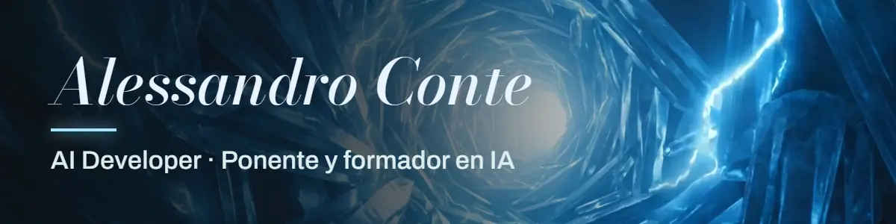
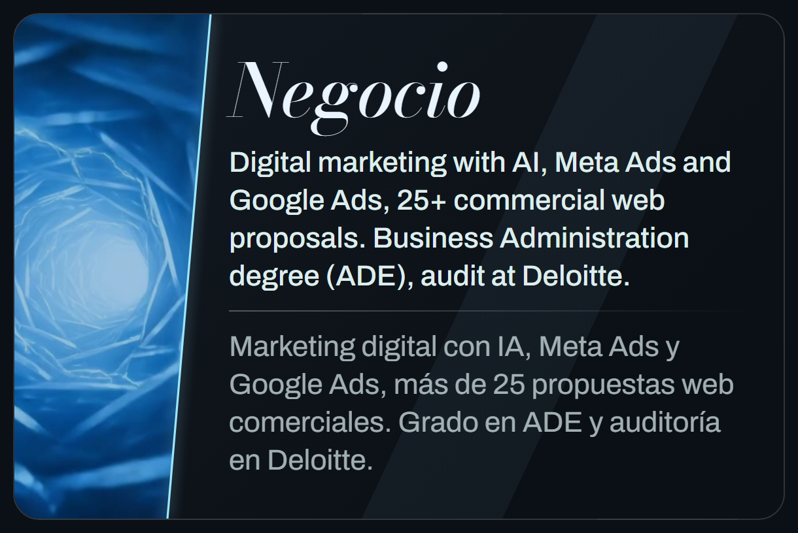
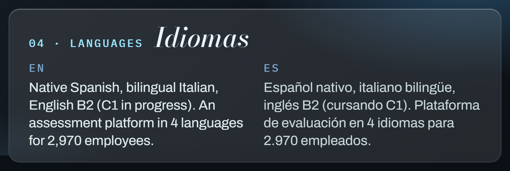

<picture>
  <source media="(prefers-reduced-motion: reduce)" srcset="assets/header-static.png">
  
</picture>

**Alessandro Conte** · AI Developer · Ponente y formador en IA / Speaker and AI trainer

[LinkedIn](https://www.linkedin.com/in/alessandrocontem)

